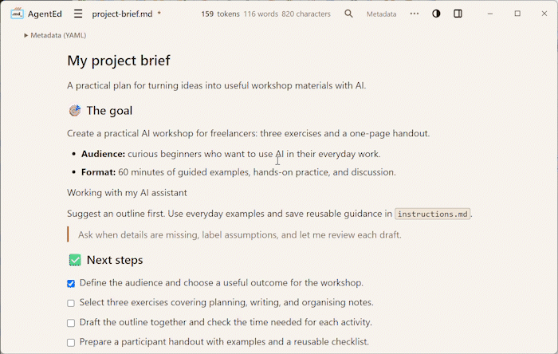
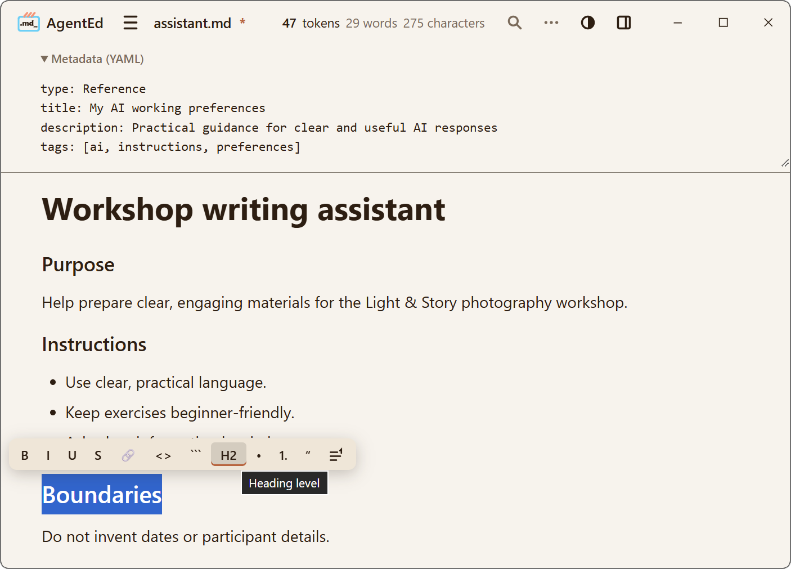
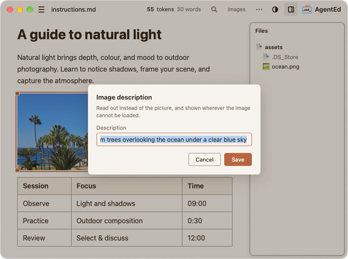

#  AgentEd — A comfortable visual Markdown editor

Turn notes, project briefs, and AI instructions into clear Markdown files. Edit visually. Keep your files.

<div align="center">

**Free · Open source · Local files · No account · No telemetry · Windows installer under 3 MB**

</div>

<div align="center">

[](https://ko-fi.com/cgxone) [](LICENSE) [](https://tauri.app/)

</div>

<div align="center">

[Website](https://agentedapp.com/) · [Windows preview](https://github.com/catge/AgentEd/releases/tag/v0.2.0-preview.2) · [Quick start](https://agentedapp.com/quick-start.html) · [Feedback](https://github.com/catge/AgentEd/issues)

</div>

<p align="center">
  
</p>

[**See AgentEd in action · 1 minute**](https://agentedapp.com/#demo)

## Why AgentEd?

Markdown is a plain-text format for headings, lists, links, and more. You may have encountered it while working with AI assistants. AgentEd lets you edit these files visually, without memorising the formatting syntax.

- **Focus on your words.** Format documents with visual controls and see the result as you write.
- **Private by design.** No account, no telemetry, no built-in cloud service. Your documents stay on your computer, and AgentEd makes no network calls of its own, which matters when your instructions carry project or client details. On Windows, the web runtime underneath connects on its own; [SECURITY.md](SECURITY.md) says when.
- **Prepare clearer AI instructions.** Keep project context, goals, preferences, and boundaries in reusable Markdown files.
- **Keep your files.** Open and save ordinary `.md` files in folders you choose, without setting up a vault or creating an account.

AgentEd helps you prepare documents for use with AI tools; it does not include an AI chat or run agents.

## Download and get started

The current test build is **v0.2.0-preview.2 for Windows x64**, prepared before the public launch. It is a pre-release and may be replaced.

[**Download the Windows preview**](https://github.com/catge/AgentEd/releases/download/v0.2.0-preview.2/AgentEd_0.2.0_x64-setup.exe) · [Release notes and SHA-256 checksums](https://github.com/catge/AgentEd/releases/tag/v0.2.0-preview.2)

The Windows installer is in the **~3 MB class**. This refers to the installer download, not the application's total installed footprint or any required runtime.

1. Download the installer from the release page.
2. Install AgentEd. This preview is unsigned; see [Windows installation](#windows-installation) below if Windows displays a warning.
3. Open an existing Markdown file or create a new document.
4. Save it to a folder on your computer.

[Read the full quick start](https://agentedapp.com/quick-start.html).

**Platforms:** Windows is the primary preview platform. The current release contains a Windows installer; it does not contain Linux or macOS packages. Experimental Linux availability and tested distributions will be documented when a build is released.

## Features

- **Visual formatting:** headings, lists, checklists, links, and tables, with a floating toolbar and Markdown input shortcuts. Add or remove table rows and columns from the menu.
- **Portable Markdown and explicit saving:** work with ordinary `.md` files and choose when to save. If a file changes on disk, choose whether to reload, overwrite, or save elsewhere. Documented format exceptions are listed in [REQUIREMENTS.md](REQUIREMENTS.md).
- **Images:** paste, drop, or insert images into a local `assets/` folder beside your document; add image descriptions for accessibility.
- **Code blocks:** select a language, copy a block with its Copy button, or use a plain-text block with soft wrapping.
- **Footnotes:** insert a reference and its note together, then hover over the reference to read it.
- **Document metadata and templates:** edit YAML front matter in the **Metadata** panel; start with a blank document or one with metadata.
- **Live counts:** tokens, words, and characters in the header. Token counting runs offline using `gpt-tokenizer` with `cl100k_base`; other models, chat formatting, and attachments can produce different totals.
- **Find and replace:** match case, whole words, or regular expressions.
- **Files panel:** browse the document's adjacent file structure in a side panel.
- **Appearance:** light, dark, automatic mode, and curated palettes.
- **Multiple windows:** work with one document in each independent window.
- **Spell check:** optional and off by default.

## For AI instructions and everyday notes

### Keep reusable AI instructions together

Write goals, preferences, and boundaries in Markdown, with YAML metadata alongside the document.

<p align="center">
  
</p>

### Explain with images and tables

Combine written instructions, illustrations, and practical details in one document.

<p align="center">
  
</p>

When sharing a document that uses local images, include its referenced `assets/` folder so the images remain available.

## Windows installation

This preview is not digitally signed. Windows may display **Windows protected your PC** or **Unknown publisher** when you open the installer.

Download from the official release linked above and check the filename and version. The release also provides SHA-256 checksums for checking that your download matches the published file.

If you have verified the source and choose to continue, select **More info**, then **Run anyway**, if Windows offers that option. An unknown publisher label does not verify the developer's identity. Managed computers or other Windows settings may prevent installation.

Do not disable antivirus protection or SmartScreen. If your antivirus reports a specific threat, stop and report the exact message and release version.

Signing is planned for a future release. [Read the installation help](https://agentedapp.com/installation-help.html).

## Keyboard shortcuts

| Shortcut | Action |
|----------|--------|
| `Ctrl+B` / `Ctrl+I` / `Ctrl+U` | Bold / Italic / Underline |
| `Ctrl+K` | Insert link (or edit / remove the link at the caret) |
| `Ctrl`/`Cmd` + click | Open a link in the system browser |
| `Ctrl+E` | Inline code |
| `Ctrl+Shift+K` | Code block |
| `Ctrl+Alt+1` … `Ctrl+Alt+6` | Heading level 1–6 |
| `Ctrl+Alt+0` | Body text |
| `Ctrl+Shift+S` | Strikethrough |
| `Ctrl+Z` / `Ctrl+Y` | Undo / Redo |
| `Ctrl+A` | Select all |
| `Ctrl+S` | Save (Save As is in the File menu) |
| `Ctrl+O` | Open |
| `Ctrl+V` / `Ctrl+Shift+V` | Paste (reads markdown) / Paste as plain text |
| `Ctrl+F` / `Ctrl+H` | Find / Replace |
| `Ctrl+Alt+F` | Footnote (Insert → Footnote does the same) |
| `Ctrl+Shift+E` | Files panel (open / close) |
| `F3` | Find next (Find Previous is in the Edit menu) |
| `Shift+Enter` | Line break inside a paragraph |
| `Tab` / `Shift+Tab` | Indent / dedent in lists; move between table cells |

---

## Known limitations

Honest edges, documented rather than discovered:

- **Line breaks inside a paragraph** are made with `Shift+Enter` or `Ctrl+Enter`. There is no button or menu entry for one.
- **A file that begins with a line of three hyphens** and has another such line further down opens with everything between them as metadata — the panel at the top — rather than as text. AgentEd never writes a file in this shape itself, so this concerns files written by hand or by another tool. Where the second line of hyphens sits inside a code block, the file opens without that block and the text after it shows as code; saving loses no bytes, but the file keeps opening this way.
- **Paste as plain text** in the right-click menu behaves like an ordinary paste — Windows hands the page the same content either way, so AgentEd cannot tell them apart. For a literal paste, use `Ctrl+Shift+V`.
- **Spell check works in one language at a time**, and on Windows that language is the first one in the Windows preferred-languages list (Settings, Language) when the checker has a dictionary for it, and the Windows display language otherwise; the list is read when AgentEd starts, so a change there applies once every AgentEd window has been closed and AgentEd opened again.
- **Insert → Metadata** is not part of undo: `Ctrl+Z` does not remove the block it adds. Deleting every field in the panel removes the block as if it had never been there.

---

## Project status

AgentEd is in active development. The preview focuses on visual editing of local Markdown files, with Windows as the primary platform.

The product definition and documented exceptions live in [REQUIREMENTS.md](REQUIREMENTS.md).

## Building from source

You need a compatible Node.js version, the Rust toolchain (via [rustup](https://rustup.rs/)), and the [Tauri platform prerequisites](https://v2.tauri.app/start/prerequisites/). Check the project's dependency requirements when choosing your Node.js version.

```sh
git clone https://github.com/catge/AgentEd.git
cd AgentEd
npm install
npm run tauri dev
```

The Tauri CLI is included in the project's development dependencies.

Production build: `npm run tauri build`

## Contributing

Contributions are welcome — please read [CONTRIBUTING.md](CONTRIBUTING.md) first. For larger changes, open an issue to discuss direction. Everything in this repository — code, docs, commits, PRs, issues — is in English.

## Support AgentEd

AgentEd is free. If it is useful to you, you can support it on [Ko-fi](https://ko-fi.com/cgxone).

Support goes to CGX Consulting SRL, the company that publishes AgentEd, and is spent on maintaining and developing AgentEd, for example:

- fixing reported bugs;
- testing on Linux;
- a macOS build, which needs an Apple developer certificate paid every year;
- new features, within what [REQUIREMENTS.md](REQUIREMENTS.md) sets out.

How money given to the project is handled is set out in [CONTRIBUTING.md](CONTRIBUTING.md#money-given-to-the-project).

AgentEd itself does not collect, store, or process any payment information. All contributions are handled entirely by Ko-fi under its own [terms and privacy policy](https://more.ko-fi.com/privacy).

## License

MIT — see [LICENSE](LICENSE).

The MIT license covers the code, not the AgentEd name or logo: a fork is welcome, under a name of its own.

## Author and contact

AgentEd is a project by **CGXC —** [**CGX Consulting SRL**](https://cgxconsulting.com/).

Built by [Cătălin Vasile](https://github.com/catge) using Claude Code. For bugs and feature requests, [open an issue](https://github.com/catge/AgentEd/issues). For other enquiries, email [contact@cgxconsulting.com](mailto:contact@cgxconsulting.com) or reach out on [X](https://x.com/CatalinG_Vasile).
