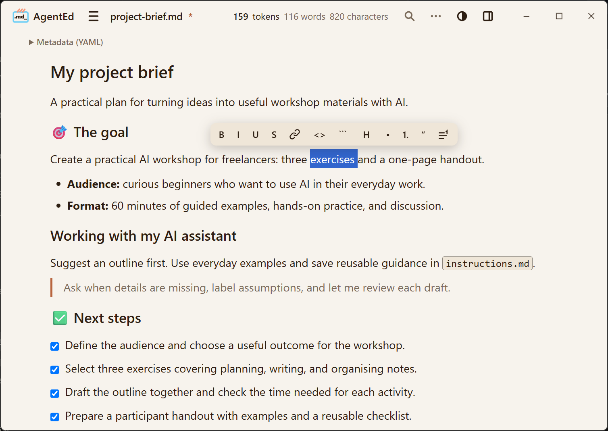

# AgentEd

**A comfortable visual Markdown editor**

Turn notes, project briefs, and AI instructions into clear Markdown files. Edit visually. Keep your files.

**Free · Open source · Local files**

[Website](https://agentedapp.com/) · [Windows preview](https://github.com/catge/AgentEd/releases/tag/v0.2.0-preview.2) · [Quick start](https://agentedapp.com/quick-start.html) · [Feedback](https://github.com/catge/AgentEd/issues)



[**See AgentEd in action · 1 minute**](https://agentedapp.com/#demo)

## Why AgentEd?

Markdown is a plain-text format for headings, lists, links, and more. You may have encountered it while working with AI assistants. AgentEd lets you edit these files visually, without memorising the formatting syntax.

- **Focus on your words.** Format documents with visual controls and see the result as you write.
- **Prepare clearer AI instructions.** Keep project context, goals, preferences, and boundaries in reusable Markdown files.
- **Keep your files.** Open and save ordinary `.md` files in folders you choose, without setting up a vault or creating an account.
- **Work offline.** No account, telemetry, or built-in cloud service. The editor works locally.

AgentEd helps you prepare documents for use with AI tools; it does not include an AI chat or run agents.

## Download and get started

The current test build is **v0.2.0-preview.2 for Windows x64**, prepared before the public launch. It is a pre-release and may be replaced.

[**Download the Windows preview**](https://github.com/catge/AgentEd/releases/download/v0.2.0-preview.2/AgentEd_0.2.0_x64-setup.exe) · [Release notes and SHA-256 checksums](https://github.com/catge/AgentEd/releases/tag/v0.2.0-preview.2)

The installer for this build is approximately **2.62 MB**. This is the download size of the installer, not the application's total installed footprint or any required runtime.

1. Download the installer from the release page.
2. Install AgentEd. This preview is unsigned; see [Windows installation](#windows-installation) below if Windows displays a warning.
3. Open an existing Markdown file or create a new document.
4. Save it to a folder on your computer.

[Read the full quick start](https://agentedapp.com/quick-start.html).

**Platforms:** Windows is the primary preview platform. The current release contains a Windows installer; it does not contain Linux or macOS packages. Experimental Linux availability and tested distributions will be documented when a build is released.

## Features at a glance

- **Visual editing:** headings, lists, checklists, links, tables, images, code blocks, and footnotes.
- **Portable Markdown:** ordinary `.md` files you can use in other tools.
- **Document metadata:** view and edit YAML front matter in a dedicated panel.
- **Live counts:** tokens, words, and characters in the header.
- **Find and replace:** match case, whole words, and regular expressions.
- **Local images:** paste, drop, or insert images, stored in an `assets/` folder next to your document.
- **Appearance choices:** light, dark, automatic mode, and curated palettes.
- **Explicit saving:** control when changes reach disk, with a warning if the file has changed outside AgentEd.

### About the token count

The live token count runs offline using `gpt-tokenizer` with the `cl100k_base` encoding. It is a useful reference when preparing text for AI tools, but it is not a universal count for every model. Other tokenizers, chat formatting, and attachments can produce different totals. AgentEd does not send your text to a model to calculate this count.

## For AI instructions and everyday notes

### Keep reusable AI instructions together

Write goals, preferences, and boundaries in Markdown, with YAML metadata alongside the document.


### Explain with images and tables

Combine written instructions, illustrations, and practical details in one document.


When sharing a document that uses local images, include its referenced `assets/` folder so the images remain available.

## Windows installation

This preview is not digitally signed. Windows may display **Windows protected your PC** or **Unknown publisher** when you open the installer.

Download from the official release linked above and check the filename and version. The release also provides SHA-256 checksums for checking that your download matches the published file.

If you have verified the source and choose to continue, select **More info**, then **Run anyway**, if Windows offers that option. An unknown publisher label does not verify the developer's identity. Managed computers or other Windows settings may prevent installation.

Do not disable antivirus protection or SmartScreen. If your antivirus reports a specific threat, stop and report the exact message and release version.

Signing is planned for a future release. [Read the installation help](https://agentedapp.com/installation-help.html).

## Editing details

<details>
<summary>Formatting, files, metadata, and editor behaviour</summary>

- **WYSIWYG editing** — inline formatting, a floating toolbar on selection, and markdown input rules (`#` + space → heading, `-` + space → list, ``` → code block — optionally with a language, `[ ]` → task list). Tables, task lists, code blocks and images are edited visually.
- **Clean round-trip** — the file you save is plain, portable markdown; opening and saving without edits never alters it. The handful of deliberate exceptions are documented, one by one, in [REQUIREMENTS.md](REQUIREMENTS.md).
- **No silent writes, no silent overwrites** — nothing reaches disk without your say-so. If the file changed on disk while you were editing, AgentEd tells you and you choose: reload, overwrite, or save elsewhere. No lock files next to your documents, ever.
- **A quiet header, not a status bar** — the live token count (`gpt-tokenizer`, cl100k_base, fully offline) with word and character counts, and search — all in one row that stays out of the way. On Windows that row is also the title bar: the AgentEd name at the left, the window buttons at the right, one bar instead of two.
- **A real menu** — File, Edit (Find and Replace, Undo, Redo, Select All, Image description, and Spell check — off by default, so technical documents stay free of noisy underlines), Insert (Table, Image, Link, Code Block, Checklist, Footnote, Horizontal Rule, Metadata, Emoji), Table (Add Row Above, Add Row Below, Delete Row, Add Column Before, Add Column After, Delete Column, Delete Table), Help. Everything the editor can do has a visible door — that is a design rule here, not an accident.
- **Code blocks** — click the language label to set the language; a hover **Copy** button on every block; a fence with no language is a plain-text box that soft-wraps — the "prompt box" familiar from AI chat tools, in plain standard markdown.
- **Images** — paste, drop, or Insert → Image; saved to an `assets/` folder next to your file, referenced with standard `` syntax, human-readable names. **Image description** — from the toolbar button on a selected image or from the Edit menu — writes what a screen reader reads out and what a renderer shows when the picture cannot be loaded.
- **Footnotes** — the bracket form GitHub reads, `[^1]` where you refer to a note and `[^1]: the note` where you write it. Make one from the floating-toolbar button, from Insert → Footnote or with `Ctrl+Alt+F`: the reference lands after what you selected and the note at the end of the document, both in one step, so one `Ctrl+Z` takes the pair back. Hover a reference to read its note without leaving your place. A document that already had footnotes opens and saves with its own spelling untouched.
- **Metadata without the jargon** — a document's title, date and other front-matter fields live in a small panel, not in raw YAML in your face. Insert → Metadata adds the block to any document; deleting every field removes it completely.
- **New from Template** — two plain seeds: a blank document, and a document with a metadata block.
- **Find & Replace** — an inline panel, match case / whole word / regex (safe-parse), `F3` navigation.
- **Files panel** — a file tree when your document has an `assets/` folder beside it and uses it. It opens and closes from the panel button at the right end of the header, or with `Ctrl+Shift+E`, and the button shows which of the two the next press will do. It sits on the right, drawn as a card, and takes its own room rather than covering what you were writing.
- **Themes** — Light / Dark / Auto and curated palettes, from the Appearance button (the half-filled circle near the right end of the header, one place in from the panel button). On Windows the whole bar, title bar included, is in the colour of your palette.
- **Multiple windows** — isolated instances, one file each.
- **Offline by design** — AgentEd makes no network calls of its own. No telemetry, no account, no cloud.
- **Lightweight** — an installer in the ~3 MB class, opens in seconds.

</details>

## Keyboard shortcuts

| Shortcut | Action |
|----------|--------|
| `Ctrl+B` / `Ctrl+I` / `Ctrl+U` | Bold / Italic / Underline |
| `Ctrl+K` | Insert link (or edit / remove the link at the caret) |
| `Ctrl`/`Cmd` + click | Open a link in the system browser |
| `Ctrl+E` | Inline code |
| `Ctrl+Shift+K` | Code block |
| `Ctrl+Alt+1` … `Ctrl+Alt+6` | Heading level 1–6 |
| `Ctrl+Alt+0` | Body text |
| `Ctrl+Shift+S` | Strikethrough |
| `Ctrl+Z` / `Ctrl+Y` | Undo / Redo |
| `Ctrl+A` | Select all |
| `Ctrl+S` | Save (Save As is in the File menu) |
| `Ctrl+O` | Open |
| `Ctrl+V` / `Ctrl+Shift+V` | Paste (reads markdown) / Paste as plain text |
| `Ctrl+F` / `Ctrl+H` | Find / Replace |
| `Ctrl+Alt+F` | Footnote (Insert → Footnote does the same) |
| `Ctrl+Shift+E` | Files panel (open / close) |
| `F3` | Find next (Find Previous is in the Edit menu) |
| `Shift+Enter` | Line break inside a paragraph |
| `Tab` / `Shift+Tab` | Indent / dedent in lists; move between table cells |

---

## Known limitations

Honest edges, documented rather than discovered:

- **Line breaks inside a paragraph** are made with `Shift+Enter` or `Ctrl+Enter`. There is no button or menu entry for one.
- **A file that begins with a line of three hyphens** and has another such line further down opens with everything between them as metadata — the panel at the top — rather than as text. AgentEd never writes a file in this shape itself, so this concerns files written by hand or by another tool. Where the second line of hyphens sits inside a code block, the file opens without that block and the text after it shows as code; saving loses no bytes, but the file keeps opening this way.
- **Paste as plain text** in the right-click menu behaves like an ordinary paste — Windows hands the page the same content either way, so AgentEd cannot tell them apart. For a literal paste, use `Ctrl+Shift+V`.
- **Spell check works in one language at a time**, and on Windows that language is the first one in the Windows preferred-languages list (Settings, Language) when the checker has a dictionary for it, and the Windows display language otherwise; the list is read when AgentEd starts, so a change there applies once every AgentEd window has been closed and AgentEd opened again.
- **Insert → Metadata** is not part of undo: `Ctrl+Z` does not remove the block it adds. Deleting every field in the panel removes the block as if it had never been there.

---


## Project status

AgentEd is in active development. The preview focuses on visual editing of local Markdown files, with Windows as the primary platform.

The product definition and documented exceptions live in [REQUIREMENTS.md](REQUIREMENTS.md).

## Building from source

You need a compatible Node.js version, the Rust toolchain (via [rustup](https://rustup.rs/)), and the [Tauri platform prerequisites](https://v2.tauri.app/start/prerequisites/). Check the project's dependency requirements when choosing your Node.js version.

```sh
git clone https://github.com/catge/AgentEd.git
cd AgentEd
npm install
npm run tauri dev
```

The Tauri CLI is included in the project's development dependencies.

Production build: `npm run tauri build`

## Contributing

Contributions are welcome — please read [CONTRIBUTING.md](CONTRIBUTING.md) first. For larger changes, open an issue to discuss direction. Everything in this repository — code, docs, commits, PRs, issues — is in English.

## Support

If you find this project useful, consider supporting its development on [Ko-fi](https://ko-fi.com/cgxone).

AgentEd itself does not collect, store, or process any payment information. All contributions are handled entirely by Ko-fi under its own [terms and privacy policy](https://more.ko-fi.com/privacy).

## License

MIT — see [LICENSE](LICENSE).

The MIT license covers the code, not the AgentEd name or logo: a fork is welcome, under a name of its own.

## Author and contact

AgentEd is a project by **CGXC — [CGX Consulting SRL](https://cgxconsulting.com/)**.

Built by [Cătălin Vasile](https://github.com/catge) using Claude Code.
For bugs and feature requests, [open an issue](https://github.com/catge/AgentEd/issues). For other enquiries, email [contact@cgxconsulting.com](mailto:contact@cgxconsulting.com) or reach out on [X](https://x.com/CatalinG_Vasile).
